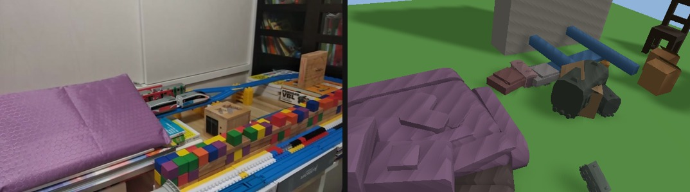
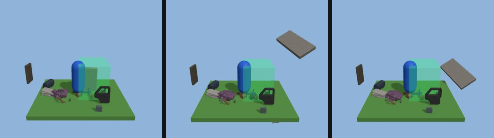
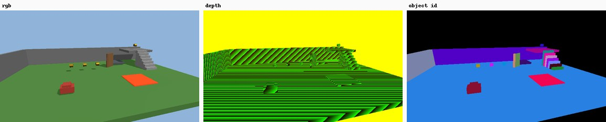
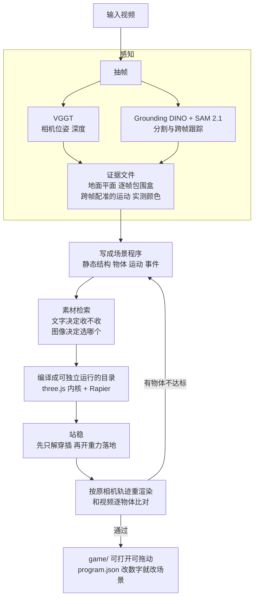
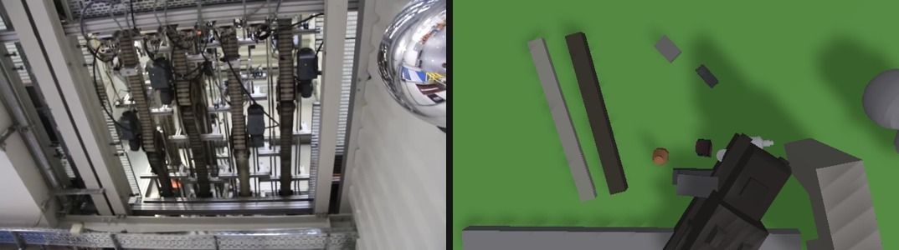

# GameWorldModel

给它一段十几秒到一分钟的普通视频，它把视频里的场景恢复成一份可执行的**场景程序**，再编译成一个能在浏览器里打开、能用鼠标直接上手摆弄的 3D 场景。中间没有人工建模。



左边是输入的视频：桌上一圈玩具火车轨道，压着一个紫色靠垫。右边是恢复出来的场景，按视频原来的相机轨迹渲染。物体的外形来自素材库检索，颜色是从视频里量出来再迁过去的。

## 我们在意的两件事

做出来的东西要同时回答两个问题。它们分开量，刻意不合成一个总分——合成之后，一个「什么都没重建出来但剩下那个能拖」的场景会拿到不低的分数，而那恰恰是最该避免的失败模式。

**像不像。** 把恢复出来的场景按输入视频原来的相机轨迹重新渲染，和原视频比。这一项有两条标尺：上限是同一段视频不同时刻之间的相似度，下限是**另一段片段重建出来的场景**——同样是低多边形渲染，唯一的差别是场景不对。不拿另一段真实视频当下限，否则量到的是画风差异，不是场景差异。

**能不能动。** 这一项过去只数程序**声明**了什么——`interaction.grab` 不是 `false` 就算一个能拖的，于是它恒等于 1.000。现在是真去抓一遍、拖一遍、松手一遍再报：在无头物理里抓住物体、提起来、横着拖、松手、等它落稳，四项判据全过才算。

## 核心主张：样式和行为是分开写的两半

做网页的时候，样式用 CSS 控制，行为用 JS 控制，两者各改各的。我们对 3D 场景做同一件事：**外形由一套机制决定，交互由另一套机制决定。**

落到代码上就是 `kernel/scene.js` 里的 `buildNode`：它返回 `{group, colliders}`，`group` 是表征，`colliders` 是交互，而碰撞体**永远**从基本体那一套算，哪怕这个节点挂着一个从素材库检索来的真网格。换外形不改变这个物体能不能被拖、怎么碰撞、物理怎么解。

这件事是量出来的，不是声称的：同一串操纵动作跑两遍，一遍用基本体，一遍把每个物体的外形换成一个形状尺寸都南辕北辙的网格，逐帧比所有物体的位置。二十条片段、合计五万三千多步仿真，**最大位置偏离 0 米**——不是「很小」，是逐位相同。

## 可交互指什么

不是一个生成出来的死板布景。拍一下卧室，床和被子应该能拖；拍一下桌子，桌上的杯子应该能拿着鼠标挪开。



三张截图是同一个由视频重建出来的场景：按住那扇棕色的门，拖到空中，松手之后它落下来靠在旁边的箱子上。这是真实浏览器里的真实鼠标事件，不是脚本调接口——指针事件绑定、画布坐标换算、射线拾取三层都走通了才会这样。

「可交互」不止这一种。我们把它分成四档，各有各的实现和各自的量法：

**观测运动**——复现视频里看到的运动。由程序的 `motion` 字段描述，内核按时间求值。

**直接操纵**——用户拖，物理求解。拖动用速度驱动而不是直接改位姿，所以碰撞、堆叠、把别的东西撞开都照常发生。手里的物体推到谁，谁就从「焊死」变成物理驱动，而不是纹丝不动。

**关节交互**——抽屉沿轴滑、柜门绕铰链转，有行程和角度限位。内核和探针都做好了，但链路目前产出不了：从视频里恢复关节轴的信号不够可靠，报出来的关节里判对的不过半，宁可不写。

**玩法交互**——角色走到目标、收集、受伤，由 `kernel/templates/` 实现，自动试玩验收。

## 怎么做到的

视频先抽帧。VGGT 估计相机位姿和深度，Grounding DINO 加 SAM 2.1 按名词短语把物体分割出来并跨帧跟踪。这些结果整理成一份证据文件：地面平面、每个物体随时间的三维包围盒、跨帧配准出来的运动、以及从掩码里量到的颜色。

物体的外形来自**检索**而不是生成：一个四千八百多个 CC0 网格的素材库，先按名字和类别打分决定收不收，再用 DINOv2 比视频里那个物体的裁剪图和素材缩略图决定选哪一个。两个分数不混成一个——照片和低多边形模型之间的图像相似度本来就偏低，混进去会把阈值带偏。选中的网格按包围盒等比缩放贴上去，再把从视频里量到的平均色迁过去，同时保留素材自己的相对色彩变化。

程序过完校验就编译成一个可以独立运行的游戏目录，固定的 three.js 内核负责解释它，Rapier 提供物理。编译之后还要让场景自己站稳：先关掉重力单跑一段只解穿插——重力解不开横向咬住的物体，它没有把它们分开的方向可用——再开重力落到支撑面上。

编译好的场景在无头浏览器里按视频原来的相机轨迹重新渲染，和视频逐物体比对，不合格的地方交给模型修订。通过之后绑定玩法模板，自动试玩一遍确认能走到终点。

比对靠的是内核额外渲染的两个通道。左边是正常画面，中间是深度，右边每个物体一种纯色，拿它和视频里分割出来的掩码算重叠，就知道哪个物体放错了位置或者大小。





## 现在做到什么程度

诚实的版本：**场景的样子有了，动起来还差得远。合成数据上的数字比真实视频好不少，两者要分开看。**

二十条带标准答案的合成片段上（223 个物体）：素材覆盖率中位数 0.63，声明可交互 1.000 而**实测 0.824**，样式与行为的解耦偏离为 0。

三段真实视频上：素材覆盖率 0.89 到 1.00，实测可交互 0.46 到 0.78，重渲染相似度归一化之后只有 0.03 上下。真实鼠标拖动在三段视频、两种视角下六次全通过。



上面是工厂输送线那段俯拍视频和它的重建。这一段比玩具火车难：视角是俯拍，地面平面只能用面向相机的主平面代替。

还明确不行的几处，每一处都有数：

- **运动估计基本不成立。** 运动类型准确率 0.086 到 0.143，真值里会动的物体几乎全被判成静止。
- **物体精确率 0.155。** 检出来的东西里大部分不对。
- **关节那一档一个都产出不了**，理由见上。
- **尺度会整体算错。** 牛顿摆那段的尺度因子偏了 3.6 倍，后果是拖一个物体会把旁边的东西甩出四十多米。
- **从视频自己的开场视角看过去，点得到的物体过半是零。** 能不能点到和能不能拖是两回事，这一项在真实视频上比合成数据差得多。

详细的排查记录、已经排除掉的假设和每一项的复现脚本在 [docs/design-notes.md](docs/design-notes.md) 和各个 issue 里。

## 上手

详细安装和资源需求看 [RUNNING.md](RUNNING.md)，分了在自己电脑上跑和在 HPC 集群上跑两种情况。最短路径是

```bash
pip install -r requirements.txt && npm install      # 再装 VGGT，见 RUNNING.md
python3 scripts/download_weights.py                 # 感知权重 9.6 GB
python3 -m gwm.run_clip --video data/clips/trimmed/我的视频.mp4 --clip 我的视频 \
  --phrases "toy train,train track,floor"
```

跑完进 `out/我的视频/<运行编号>/`，`node harness/serve.mjs game 8000` 就能在浏览器里打开。**按住鼠标左键就能把物体拖起来**，松手物理接管。WASD 移动，空格跳，R 在回放和游玩之间切换——两种视角下都能拖。

不想下权重也能先玩起来：`python3 -m gwm.compiler.compile examples/handwritten/program.json /tmp/game` 把仓库里手写的示例场景编译成游戏，改 JSON 里的数字再编译一次，就能看出场景程序是怎么控制游戏的。

## 文档

| 看什么 | 去哪 |
|---|---|
| 项目在做什么、关键术语、新人从哪读起 | [docs/overview.md](docs/overview.md) |
| 怎么装、怎么跑、需要多少资源 | [RUNNING.md](RUNNING.md) |
| 想改代码，PR 流程和代码约定 | [CONTRIBUTING.md](CONTRIBUTING.md) |
| 系统怎么搭的：模块、数据流、接口契约、场景程序 DSL | [docs/architecture.md](docs/architecture.md) |
| 每一层为什么这么选：感知、模型、反馈、运行时、素材 | [docs/design-notes.md](docs/design-notes.md) |
| 每一项指标现在是多少、怎么量的、排除过哪些假设 | [docs/design-notes.md](docs/design-notes.md) |
| 更早的结果记录（多数停在 2026-09，数字已被后续改动推翻，看前先对一下日期） | [docs/status.md](docs/status.md) |
| 三段视频的实际产物，报告和截图 | [docs/results/](docs/results/) |
| 相关工作 | [docs/related-work.md](docs/related-work.md) |
| 研究提案（开工前写的，与 issue 冲突处以 issue 为准） | [RP.md](RP.md) |
| 前期调研的原始报告 | [survey/](survey/) |

## 项目目录

```
gwm/                  Python 管线，入口是 run_clip.py
  perception/         抽帧、几何、分割、证据提取（后端可换）
  synthesis/          模型客户端、三阶段生成、批评、修订循环、证据直译
  compiler/           JSON Schema、校验、素材解析、打包成 game 目录
  feedback/           调渲染、算指标、出逐物体的 pass/fail 子句
  binding/            玩法绑定，推断出生点目标收集物
  playtest/           自动试玩和判定
  config.py errors.py taxonomy.py
kernel/               浏览器里的固定运行时，只吃数据不含生成代码
harness/              Playwright 驱动内核做渲染、试玩、录像
compiler 的 schema、configs/、prompts/、examples/、tests/、scripts/
docs/                 设计文档、结果、配图
survey/               调研原始报告
data/clips/           视频          ┐
out/                  每次运行的产物 ├ 都不进 git
.secrets/             API key       ┘
```

Evidence 契约与质量门禁、多帧关联、世界坐标运动估计、候选程序验证和保守修复、渲染结果验证已接入管线。接口、默认策略及配置分组见 [设计说明](docs/design-notes.md#证据与验证门禁)。
