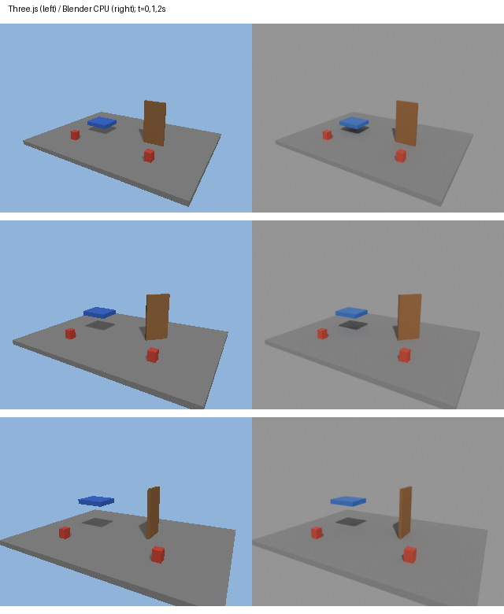

# Cross-engine shared-state rendering pilot (Issue #90)

This pilot renders one known synthetic Program in Three.js and Blender. It is a
small rendering bridge, not the completed cross-engine benchmark or evidence of
independent motion/physics agreement.

## Data flow

1. Compile `examples/cross_engine/program.json` with the existing compiler.
2. `harness/export_frozen_scene.mjs` starts the production kernel in scene-only
   mode, seeks the requested times, and exports actual mesh vertices, triangles,
   world matrices, camera, visibility and runtime state. It also saves Three.js
   RGB frames, exact Program bytes and hashes of all compiled game files.
3. `scripts/cross_engine/render_blender.py` reads that packet, creates Blender
   meshes, assigns the same per-sample matrices, and renders RGB using CPU Cycles.
   It verifies imported vertices/matrices and off-centre camera projection probes
   before rendering. A mismatch stops the run with a failing exit code.

The existing production motion/camera functions evaluate the truth once. Blender
does **not** interpolate a second trajectory. The resulting paired views share
that evaluated truth, as required for a renderer-domain subset. This cannot test
whether two independently implemented dynamics systems agree.

## Commands

Use repository `package-lock.json` dependencies and the normal Python environment.
Install Playwright Chromium if it is not already available. Blender must be
installed separately; its path can be absolute.

```sh
python -m gwm.compiler.compile examples/cross_engine/program.json out/cross/game
node harness/export_frozen_scene.mjs --game out/cross/game --out out/cross/three --times 0,1,2 --width 320 --height 240
blender -b --factory-startup --python-exit-code 1 --python scripts/cross_engine/render_blender.py -- out/cross/three/frozen_scene.json out/cross/blender
node --test tests/test_frozen_scene.mjs
python -m pytest tests/test_blender_packet.py -q
```

Both exporter/importer refuse an existing output directory. Failed run artifacts
are retained; choose a new output directory for any explicitly requested rerun.
The Blender `report.json` records packet SHA256, engine version, CPU device,
sample times, imported instance IDs, matrices and numeric parity errors.

For every frame of the two-second 30 FPS clip, replace `--times 0,1,2` with
60 times `i/30`, `i=0..59`. For example in PowerShell:

```powershell
$times = node -p "Array.from({length:60},(_,i)=>i/30).join(',')"
node harness/export_frozen_scene.mjs --game out/cross/game --out out/cross/full-three --times $times --width 320 --height 240
blender -b --factory-startup --python-exit-code 1 --python scripts/cross_engine/render_blender.py -- out/cross/full-three/frozen_scene.json out/cross/full-blender
```

## Coordinates and checks

- Keep the Program's Y-up world coordinates in both engines. Blender does not
  require rotating the scene to its conventional Z-up orientation for rendering.
- Three.js serializes matrices column-major; Blender takes rows. `matrix_rows`
  converts storage layout, without changing the coordinate system.
- Both camera local frames look down -Z with local +Y up. Three.js vertical FOV
  maps to Blender `sensor_fit=VERTICAL`, sensor height 36 mm and
  `lens=18/tan(fov/2)`.
- Gates: maximum imported vertex/matrix absolute error <= 1e-5 world units,
  projection error <= 1e-4 NDC. These are import tolerances, not measured real-world
  accuracy or reconstruction metrics. Requested and actual sample time must match.
- Repeated instances use their expanded names (for example `markers#2`), so two
  instances cannot silently share the same exported mesh ID.

Camera reference: [Blender Camera API](https://docs.blender.org/api/3.6/bpy.types.Camera.html).

## Deliberate pilot boundaries

Only authored primitive geometry with opaque, untextured, single-sided materials,
no events, and non-simulated motion is accepted. Assets are rejected explicitly,
including runtime primitive fallbacks; skinned/instanced/morph meshes and unsupported
materials also fail. Ordinary Program `instances` are expanded and supported.
Nothing is substituted with a box by this bridge.

Blender uses separate neutral lighting and its own shading; RGB values are not
expected to match Three.js. No depth/ID render, collision or mouse-interaction
equivalence is claimed. The default three-time check is not complete per-frame
coverage; the 60-frame command covers one clip only. No model, paid API, reconstruction, training, PartNet
download, GT inference input or historical experimental artifact is involved.

## Local Windows verification (2026-10-28)

Base: `77f79ca5150a5de996e2e39fb77d7f9fe314a01e`, with only this additive bridge.
Locked Three.js 0.186.0, Playwright 1.63.0 / Chromium headless shell 1243;
Blender 4.5.15 LTS build `5afeabba6097`, CPU Cycles with eight samples.
The portable official ZIP was verified against the official SHA256 manifest:
`52dd02fd74877fa08e74b67d7854cf32468a232c02aaa19b6844c91285574f8d`.

- Program validation: zero errors or warnings; no asset requests.
- Related regression: 33 Python and 25 Node tests passed, no skips. This is not a
  full repository regression.
- Initial wiring check: three sample times 0/1/2 seconds rendered in both engines.
- Full short clip: 60 frames in each engine at `i/30`, 0 to 1.9666666666666666 s;
  five runtime instances per frame, 300 imported mesh poses checked.
- Maximum matrix error `2.2252400722067023e-7`, vertex error `0`, and camera
  projection error `3.7610317038527796e-7` NDC. All import gates passed.
- Browser error/pageerror/requestfailed: zero. No model, paid API or physical GPU.
- Program SHA256: `174703e3b2012217efef19e945e23116eb76e47da9f362a98235680bff468ce2`.
- Full packet SHA256: `d9c992756646d51a6b966ff7e7dc9d4ce91bd2ff1ee4c03d6e45e3398d8fcb23`.



The initial Blender lighting was too dark on visual inspection; its neutral world
and sun are now explicit. Image appearance is deliberately not scored as an RGB
match. The public fixture is synthetic; these boxes represent the fixture's
authored primitives and are not substituted assets from a real video.
