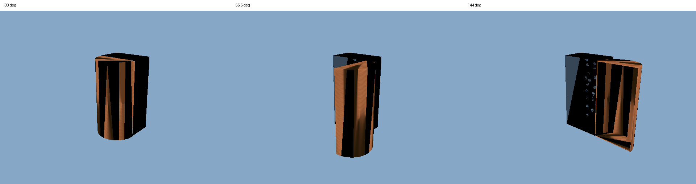

# PartNet single-hinge import pilot

This bridge reads a privately obtained PartNet-Mobility ZIP, generates two real
GLB meshes and an existing-schema Program, validates it, and bundles it using the
production kernel. Dataset files and derived GLBs belong in ignored private
output directories, not Git or public releases without the applicable permission.

## Supported subset

Exactly one finite revolute joint whose child is a leaf; every other joint must
be fixed. Visuals must reference OBJ meshes within the asset folder. All fixed
links are combined into `body`; the moving leaf becomes `lid`. Missing meshes,
unsupported joints/mimics, invalid limits or invalid source SHA256 fail explicitly.
No primitive substitutions or geometric repairs are performed.

The converter bakes each visual's mesh scale, visual origin and fixed ancestor
transforms into its rest vertices. It then centres the two GLBs and records those
centres as Program positions. The source joint axis and pivot are transformed to
world coordinates for the existing `revolute` evaluator. No new DSL hierarchy or
state field is introduced; original link/joint mapping remains in the sidecar.

For the imported rest-world point p, its moving position at source angle q is:

```text
p(q) = pivot + Rotation(world_axis, q) * (p - pivot)
```

The state-preview slider maps time 0..1 to the source lower..upper angle using an
existing motion schedule. It is a kinematic inspection interface, not a physical
hinge or the proposed new task's full shared mouse/state API. Dragging is disabled
in the generated Program because release persistence and collision constraints
have not been verified for this importer.

## Run

```sh
PYTHONPATH=. python scripts/partnet/import_asset.py SOURCE.zip NEW_OUT --sha256 EXPECTED_SHA256 --revision SOURCE_REVISION
node harness/partnet_check.mjs --import NEW_OUT --out NEW_CHECK_OUT
python -m pytest tests/test_partnet_import.py tests/test_assets.py -q
```

The importer refuses existing output paths. `NEW_OUT/game/joint_preview.html`
can be served with the existing harness server for state inspection. The browser
check requires both GLBs to load successfully, compares three runtime poses with
source-derived reference states, checks mesh topology counts, exercises the state
slider, and rejects browser errors.

Outputs include `program.json`, `validation.json`, `asset_manifest.json`, two GLBs,
`source_mapping.json`, and the compiled game. No API/model/GPU is needed.

## Provenance and limits

The explicit asset manifest retains PartNet-Mobility research terms and upstream
ShapeNet conditions. It deliberately bypasses the current CC0 catalog resolver,
which would otherwise label every library match CC0. It still uses the production
validator and bundler; no source licence is changed.

GLBs currently use diagnostic solid colors and generated normals. Source textures,
material appearance, collision meshes, inertials and physical scale calibration
are not imported. OBJ polygons are fan-triangulated; general concave polygon
triangulation has not been implemented. The source coordinates are retained under
URDF conventions; no manual normalization or object placement is applied.

This first flattened fixed-root subset does not support a movable parent, multiple
joints, or the administrator's future hierarchical DSL. It should be extended only
against the agreed interface, rather than treating baked fixed transforms as full
hierarchy support. Mechanical limit endpoints are not asserted to be visually
closed/open states.

## GLB transport diagnosis

SOAR diagnostic 10502 compared the unchanged cached GLBs through the production
FileLoader path and native Fetch. Both paths returned the complete bytes, matching
the on-disk SHA256, and both parsed the meshes. In this runtime, FileLoader still
produced Chromium `ERR_ABORTED` events, whereas native `fetch().arrayBuffer()` plus
`GLTFLoader.parseAsync()` produced no such events. The lower-level Chromium/stream
trigger has not been established; this comparison rules out truncated model bytes
in the tested responses and isolates the observed symptom to that loading path.

`kernel/assets.js` now consumes the native response before parsing, checks HTTP
status explicitly, and passes the original asset directory into `parseAsync` so
relative resources retain their base URL. Transport and parse errors remain
recorded in `failures`; browser `requestfailed` events are not filtered out.
Tests cover native-byte parsing, resource-base resolution, HTTP failure, transport
failure, invalid glTF, and an empty manifest. The test does not prove textured
external-resource assets work in every browser; source texture import is still
outside this pilot.

## Verified source-asset example

SOAR CPU job 10503 reused the Program and GLBs produced by job 10500, verified
their bytes were unchanged, and passed browser acceptance on 2026-10-28. Source:
asset 100247, dataset revision `ee0aa3ef1df16181d76d83f7415aa8c94ed1da8f`,
archive SHA256 `c3cc68372dd82cfd723e792d6b9bbd6c17a46fc67b7a03ef1e705dec8f3b732c`.

- Both real meshes loaded; no asset failures or browser error/pageerror/requestfailed.
- Angles: -33, 55.5 and 144 degrees; these mechanical limits do not assert semantic
  closed/open states.
- Maximum node-position error `1.1102230246251565e-16`; rotation-matrix element
  error `2.220446049250313e-16` against source-derived states.
- Body: 50,359 vertices / 199,778 triangles; lid: 30 vertices / 108 triangles.
- Scripted UI state-slider check reached time 0.5. No human interaction claim.
- Program validation had no errors, with the existing `no_static` warning retained.
- Related Python tests: 36 passed in SOAR job 10500. Current related Node tests:
  38 passed locally, including a later interrupted-response-body negative case.
  This is not a full repository regression.



Diagnostic colors and generated normals are used. No texture fidelity, physics
dragging, collision, or multi-joint support is claimed. No dataset ZIP, OBJ or
derived GLB is included in this change.
