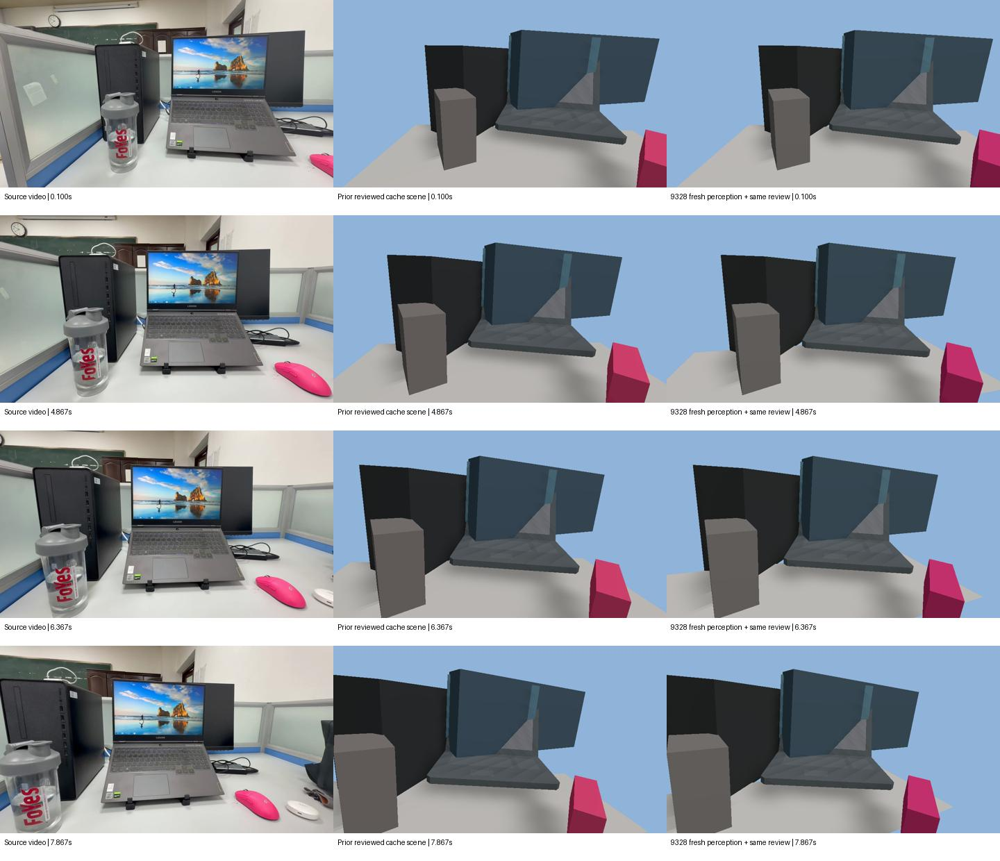

# 自拍视频重建进展：2026-10-22

Related: #32。进展记录，不是验收通过声明。

## 实验范围

用户自拍视频截取的8秒片段，240帧；输入SHA256为`e187660c62e47f43e7662c7bff993684d10f14aa6500463949144f55dda3a6ce`。源码冻结于`abd98fac741bf7d816fa1eb6ca0bf981d856874c`，父提交`3fed57bcef690d2f9ed01e7b90b3af662d84786c`，不是最新main的运行结果。实验代码暂未随本文档提交。

采用历史6个固定对象短语、seed=0，VGGT几何与Grounding DINO/SAM2分割，无几何或分割兜底；关闭旧接地位置替换/接地声明。未调用命名或Writer API，未输入真值。该选择验证感知与确定性翻译路线，不是LLM Writer效果实验。

## 执行与结果

| 步骤 | 实际结果 |
|---|---|
| CPU预检9325 | 输入视频/完整容器/审核配置哈希核对；34项Python、18项Node相关测试通过 |
| 首次GPU9326 | 包装脚本缺少paths初始化而失败，尚未加载模型；历史失败保留 |
| CPU修复验证9327 | 4项回归及正式脚本准备路径通过，模型导入前停止 |
| GPU补跑9328 | COMPLETED/0:0，3分22秒；1张RTX PRO 5000 72GB，8 CPU、32 GiB；7对象 |
| Evidence | 0校验错误、459警告，Quality Gate=warn |
| 派生预览 | 本地CPU确定性翻译/编译，0.100、4.867、6.367、7.867秒各输出RGB/depth/ID；7注册项，Render Validation=proceed、无诊断，browser error/pageerror/requestfailed=0 |

CPU预检为相关测试而非全量测试。本阶段API调用为0，不延伸为历史试验未花费API。没有自动重试、重新感知追加作业或改写旧实验。

预览复用已有审核资产引用与显示策略，统一类别先验尺度因子0.319；未单独移动物体、Repair或物理落位。不生成未观测地板，使用scene_only，不添加玩家、目标或自动玩法绑定。人工/助手审核的桌面显示面与朝向是假设，不是真值。

## 肉眼验收：尚未达到目标

四个时间点逐张查看，和上一版审核缓存场景基本相同。鼠标仍显示为基本体替代；屏幕、笔记本、主机的结构与外观仍粗糙。该比较不是原9172最终场景，也不是正式受控A/B。

时间分别为0.100、4.867、6.367、7.867秒。新旧重建复用相同的已有审核资产和显示策略；截图正常显示不代表几何准确。

| 诊断 | 上一审核缓存版 | 9328派生版 |
|---|---:|---:|
| 鼠标/笔记本长边比例 | 42.83% | 42.53% |
| 笔记本/主机OBB相交 | 是 | 是 |
| SAT最小轴重叠 | 0.013184 | 0.005639 |

SAT数值是按同一类别先验尺度缩放的包围盒诊断，不是真实网格穿透深度或独立米制精度；数值减小不能证明几何正确。鼠标7/32帧通过当前尺寸样本筛选，桌面0/32，其余对象有合格样本；合格仅表示满足筛选条件，不能排除深度系统偏差、遮挡或平滑污染。

## 尚未验证与下一步

- 未证明真实尺寸、深度、接触或遮挡关系正确；未进行本轮拖动/行走/完整玩法验收，没有完整重建对照视频。
- 当前结果不能关闭#32，也不是Issue #3颜色收益或正式重跑结论。
- 停止重复同条件GPU/API，优先检查鼠标、笔记本、主机的mask、源图三维盒投影、资产形状/轴向相容性。具体偏差责任仍待确认，不能一律归因于LLM或某个模型。
- 若后续人工指定尺寸或位姿，单独记录为人工修正版，不当作自动感知改善。

现有证据包括输入/容器/脚本身份、原失败回溯、9328 Evidence及校验/质量/尺寸诊断、新旧几何对照JSON、四时刻源图/前版/新版拼图及浏览器渲染索引。本PR附上述一张三列对照拼图，不上传原视频、其余截图、权重、大缓存、服务器个人路径或凭据。
